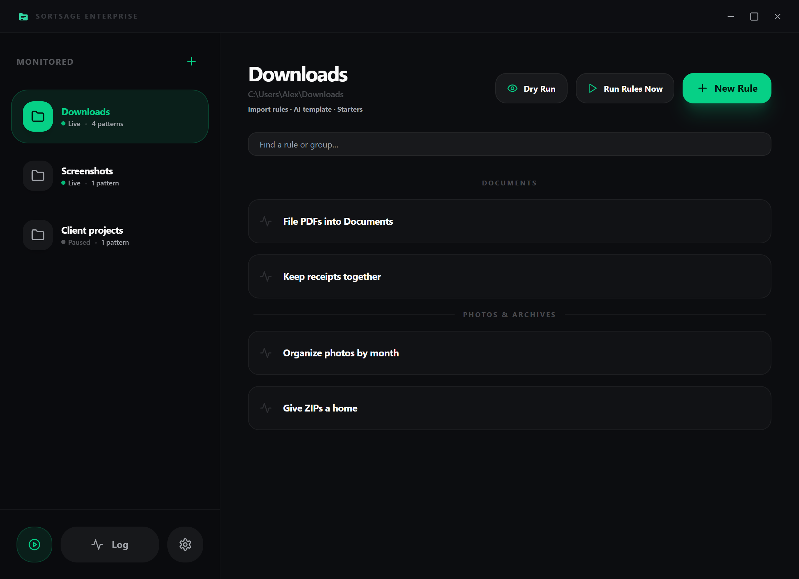
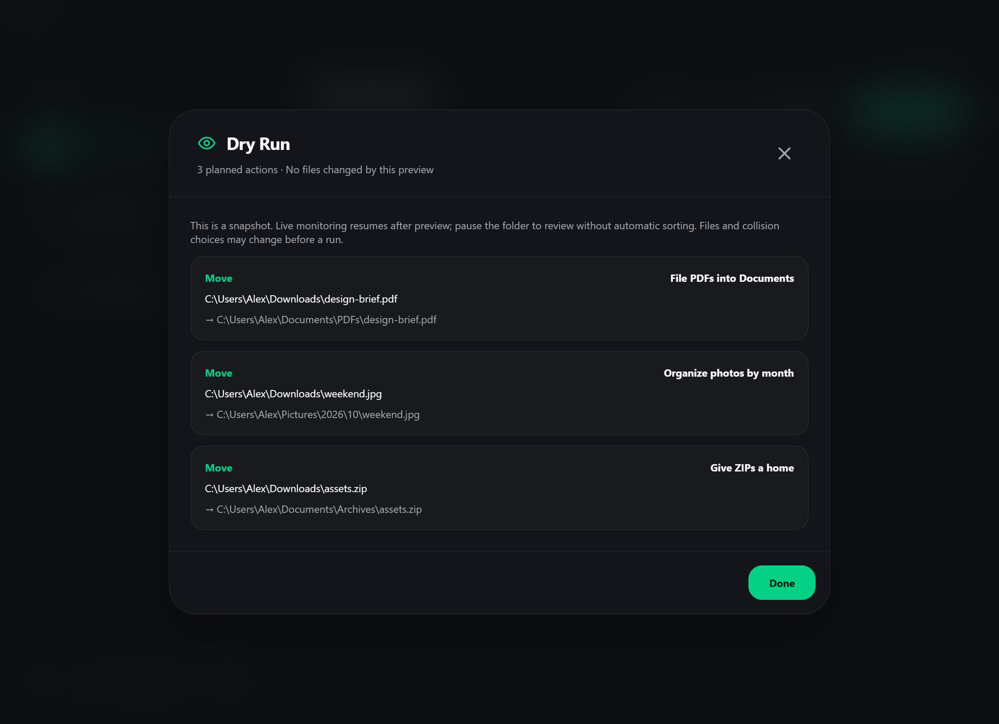

# SortSage for Windows

Start with a copy-first rule for your Downloads folder. These JSON packs let you see which files SortSage would copy before you run anything. They require the SortSage desktop app.

[SortSage](https://enlightpixel.com/products/sortsage) · [Official downloads](https://enlightpixel.com/products/sortsage/download) · [EnlightPixel](https://enlightpixel.com/)

| Pack | Matches | Copies to |
| --- | --- | --- |
| [Downloads](packs/downloads.json) | PDF and ZIP files | Separate PDFs and Archives folders |
| [Screenshots](packs/screenshots.json) | PNG names beginning with Screenshot | Screenshots folder |
| [Invoices](packs/invoices.json) | PDF names containing invoice | Invoices folder |

1. Download one JSON pack and open it in a text editor. Replace every example destination with an absolute path you own and can write to. Put it outside any monitored source tree.
2. In SortSage, select a scratch folder containing copies of a few representative files and import the JSON in the rules interface.
3. Review the imported rules. Enable only the rules under test, keep automatic triggering off, and inspect Dry Run before executing. Check unmatched files too.
4. Run the rule on the samples and check the new copies. Every pack starts disabled, uses Copy, and requests SmartRename on a collision. Change to a move only after testing and making a backup.

These packs match names and extensions. They won't read invoice contents or catch screenshots with different names. [SortSage documentation](https://enlightpixel.com/products/sortsage/docs)

## In the app

Review the rules for your test folder before enabling a pack.

Open Dry Run to check the matched files and their proposed destinations.

## Check a preview

| Pack | Sample names that should match | Sample name that should stay unmatched |
| --- | --- | --- |
| Downloads | `Proposal.pdf`, `Project.zip` | `Notes.txt` |
| Screenshots | `Screenshot 2026-11-17.png` | `Team photo.png` |
| Invoices | `Invoice 114.pdf` | `Invoice 114.xlsx` |

To suggest a pack or report a mismatch, open an issue with the pack name, SortSage version, and made-up filenames that reproduce it. Send billing and license questions to [private support](https://enlightpixel.com/contact).
